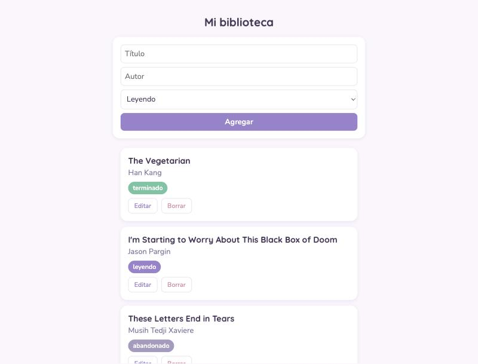
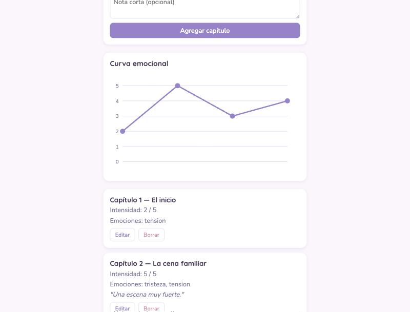
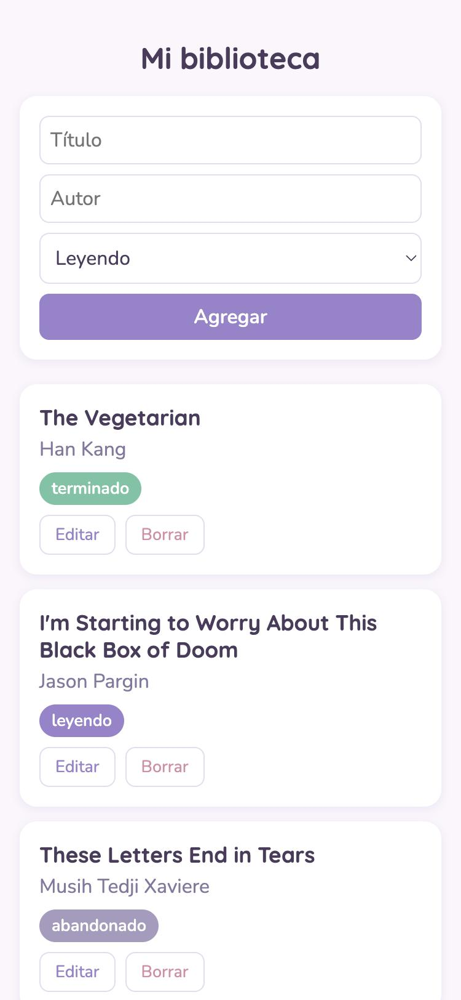

# Diario emocional de lectura

Una app web personal para registrar cómo me hace sentir cada capítulo de los libros que leo, inspirada en [howsadisthischapter.com](https://howsadisthischapter.com), pero con mis propias calificaciones.

**[Ver la app en vivo](https://johasalas-boop.github.io/reading-diary-app/)**

## Capturas







## Qué hace

- Biblioteca de libros con estado (leyendo, terminado, abandonado).
- Registro por capítulo: intensidad emocional (slider de 0 a 5), emociones como tags seleccionables —con la opción de agregar las propias— y una nota corta opcional.
- Curva emocional: un gráfico que muestra cómo varía la intensidad capítulo a capítulo.
- Editar y borrar tanto libros como capítulos.
- Guardado permanente en el navegador: los datos no se pierden al recargar la página.
- Modo de ejemplo con libros inventados, para que cualquiera pueda probar la app sin ver datos reales.

## Cómo está hecho

HTML, CSS y JavaScript sin frameworks ni librerías: cada línea fue escrita para poder entenderla, no solo para que funcione. El gráfico de la curva emocional está dibujado a mano con SVG.

- **Frontend:** HTML + CSS + JavaScript vanilla
- **Datos:** `localStorage` del navegador
- **Gráficos:** SVG generado con JavaScript
- **Despliegue:** GitHub Pages

## Qué aprendí construyendo esto

Este es mi primer proyecto programando, armado paso a paso con ayuda de Claude Code. Algunos de los conceptos que fui aprendiendo en el camino:

- Manipulación del DOM y eventos (`addEventListener`).
- Guardado de datos en el navegador con `localStorage`.
- Cómo dibujar gráficos con SVG directamente desde JavaScript.
- Variables CSS para armar una paleta de colores reutilizable.
- Especificidad en CSS, y por qué un selector le puede "ganar" a otro sin que se note a simple vista.
- Git y GitHub: commits, remotos, llaves SSH y despliegue con GitHub Pages.
- Que el plan inicial cambia: varias funcionalidades (editar/borrar, emociones como tags extensibles) surgieron probando la app, no estaban en el plan original.

## Privacidad

El código es público, pero mis registros de lectura reales nunca se suben a este repositorio: se guardan solo en mi dispositivo. Lo que ves en la demo es el modo de ejemplo, con libros y capítulos inventados.

## Correrlo en tu computadora

No necesita instalación. Cloná el repositorio y levantá un servidor local:

```bash
git clone https://github.com/johasalas-boop/reading-diary-app.git
cd reading-diary-app
python3 -m http.server 8000
```

Después abrí `http://localhost:8000` en tu navegador.
